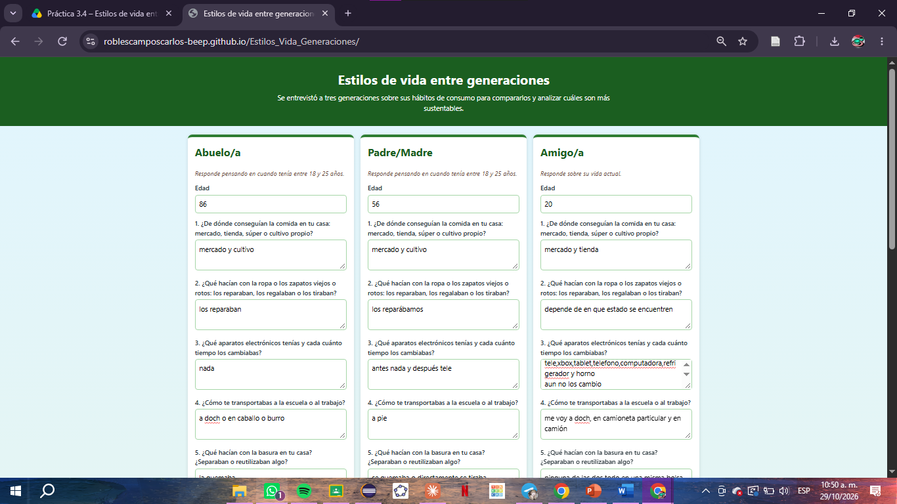
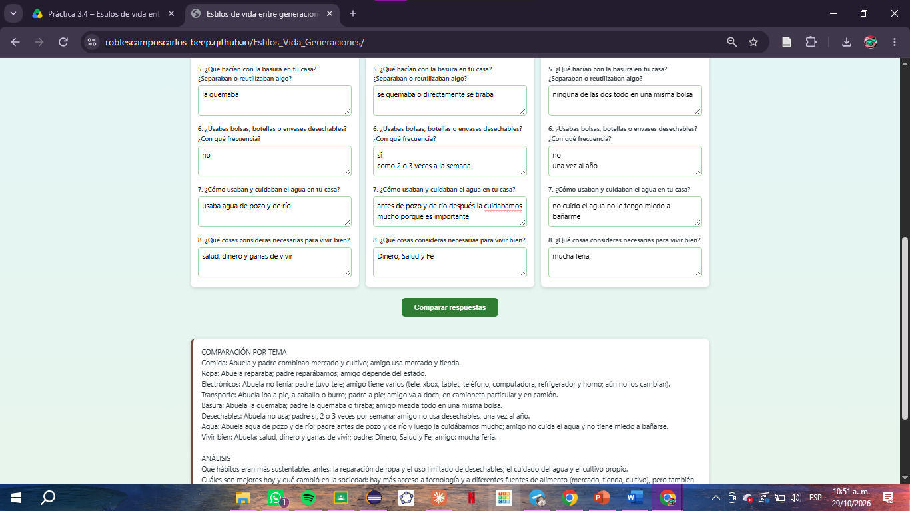

# Práctica 3.4 – Estilos de vida entre generaciones

| Dato | Valor |
|---|---|
| Estudiante | Roberto Carlos Robles Campos |
| Escuela | Tecnológico Nacional de México – Instituto Tecnológico de Mazatlán |
| Materia | Desarrollo Sustentable (ACD-0908) |
| Práctica | 3.4-P8 Página web "Estilos de vida entre generaciones" |

**Página publicada:** https://roblescamposcarlos-beep.github.io/Estilos_Vida_Generaciones/
**Código:** [`codigo/index.html`](codigo/index.html) (la misma página; una copia está en la raíz para que GitHub Pages la publique) · **Escenario de Make:** [`codigo/blueprint.json`](codigo/blueprint.json) · **Resultados (PDF):** [`resultados/Resultados.pdf`](resultados/Resultados.pdf)

## 1. Objetivo
Distinguir los estilos de vida y de consumo de tres generaciones de mi entorno, construir sin programar una página web conectada a Make e IA para compararlas y formular conclusiones propias sobre su sustentabilidad.

## 2. Cómo funciona
Flujo: **Página web → Make (Webhook → Make AI Agent → Webhook Response) → Página web**.

1. La página (`index.html`, un solo archivo con HTML, CSS y JavaScript) reúne las respuestas de las tres personas y las envía por POST con `URLSearchParams` en tres campos: `abuelo`, `padre` y `amigo`.
2. El escenario `Generaciones_RobertoRobles` en Make recibe los datos con un Custom webhook.
3. El Make AI Agent (conexión Make's AI Provider, sin Knowledge) compara las respuestas con las instrucciones de la práctica y usa solo lo que dicen las entrevistas.
4. Webhook Response devuelve el análisis en texto plano (estado 200, `Content-Type: text/plain; charset=utf-8`, `Access-Control-Allow-Origin: *`) y la página lo muestra.

Consumo: en el historial del escenario, cada análisis gastó entre **3.56 y 3.63 créditos** (≈ 3.6), con 3 operaciones y entre 7 y 9 segundos de duración.






## 3. Entrevistas
Se hicieron las mismas 8 preguntas a tres personas. Solo se registró la edad, no el nombre. El abuelo y el padre respondieron pensando en cuando tenían entre 18 y 25 años; el amigo, sobre su vida actual. Las respuestas están tal como se capturaron en la página.

| # | Pregunta | Abuelo/a (86 años) | Padre/Madre (56 años) | Amigo/a (20 años) |
|---|---|---|---|---|
| 1 | ¿De dónde conseguían la comida? | mercado y cultivo | mercado y cultivo | mercado y tienda |
| 2 | ¿Qué hacían con la ropa o zapatos viejos? | los reparaban | los reparábamos | depende de en qué estado se encuentren |
| 3 | ¿Qué aparatos electrónicos tenías y cada cuánto los cambiabas? | nada | antes nada y después tele | tele, xbox, tablet, teléfono, computadora, refrigerador y horno; aún no los cambió |
| 4 | ¿Cómo te transportabas? | a doch o en caballo o burro | a pie | me voy a doch, en camioneta particular y en camión |
| 5 | ¿Qué hacían con la basura? | la quemaba | se quemaba o directamente se tiraba | ninguna de las dos (separar o reutilizar), todo en una misma bolsa |
| 6 | ¿Usabas bolsas, botellas o envases desechables? | no | sí, como 2 o 3 veces a la semana | no / una vez al año |
| 7 | ¿Cómo usaban y cuidaban el agua? | usaba agua de pozo y de río | antes de pozo y de río, después la cuidábamos mucho porque es importante | no cuido el agua, no le tengo miedo a bañarme |
| 8 | ¿Qué es necesario para vivir bien? | salud, dinero y ganas de vivir | Dinero, Salud y Fe | mucha feria (dinero) |

> Nota: en la entrevista del amigo/a, la pregunta 6 se registró como "no" y "una vez al año". La respuesta no quedó del todo clara, y esa ambigüedad afecta al análisis de la IA. Tampoco queda claro qué significa "doch" en la pregunta 4; se dejó tal como lo dijeron.

## 4. Análisis generado por la IA
```
COMPARACIÓN POR TEMA
Comida: Abuela y padre combinan mercado y cultivo; amigo usa mercado y tienda.
Ropa: Abuela reparaba; padre reparábamos; amigo depende del estado.
Electrónicos: Abuela no tenía; padre tuvo tele; amigo tiene varios (tele, xbox, tablet, teléfono, computadora, refrigerador y horno; aún no los cambian).
Transporte: Abuela iba a pie, a caballo o burro; padre a pie; amigo va a doch, en camioneta particular y en camión.
Basura: Abuela la quemaba; padre la quemaba o tiraba; amigo mezcla todo en una misma bolsa.
Desechables: Abuela no usa; padre sí, 2 o 3 veces por semana; amigo no usa desechables, una vez al año.
Agua: Abuela agua de pozo y de río; padre antes de pozo y de río y luego la cuidábamos mucho; amigo no cuida el agua y no tiene miedo a bañarse.
Vivir bien: Abuela: salud, dinero y ganas de vivir; padre: Dinero, Salud y Fe; amigo: mucha feria.

ANÁLISIS
Qué hábitos eran más sustentables antes: la reparación de ropa y el uso limitado de desechables; el cuidado del agua y el cultivo propio.
Cuáles son mejores hoy y qué cambió en la sociedad: hay más acceso a tecnología y a diferentes fuentes de alimento (mercado, tienda, cultivo), pero también mayor consumo de desechables y menos cuidado explícito del agua.
Qué cambió en la sociedad para explicarlo: mayor disponibilidad de productos electrónicos y transporte variado, urbanización y consumo diferenciado entre generaciones.

CONCLUSIONES
1. Reparar y reutilizar ropa era una práctica común y debe retomarse como hábito sustentable.
2. Reducir el uso de desechables y gestionar mejor la basura y el agua son acciones que se pueden incorporar hoy.
3. Acción concreta que podría retomar la generación actual: fomentar y normalizar la reparación de ropa y productos en lugar de desecharlos, reduciendo así residuos y consumo.
```

## 5. Revisión de las conclusiones de la IA

| Conclusión de la IA | ¿De acuerdo? | Por qué |
|---|---|---|
| 1. Reparar y reutilizar ropa era común y debe retomarse | **Sí** | Coincide con las respuestas: el abuelo y el padre dijeron que reparaban la ropa. |
| 2. Reducir desechables y gestionar mejor la basura y el agua | **Sí, con matiz** | Es razonable, pero la IA no dijo que la basura se quemaba, que contamina el aire. "Gestionar mejor" es muy general. Y sobre los desechables, el padre (2 o 3 veces por semana) usaba más que el amigo/a ("una vez al año"). |
| 3. Normalizar la reparación de ropa y productos en lugar de desecharlos | **Sí, pero repite la 1** | Es una acción concreta y viable. Sin embargo, la 3 es casi la misma que la 1 y no aporta una acción distinta (por ejemplo, separar la basura o cuidar el agua). |

**Lo que dejó fuera o interpretó mal:**
- Dijo "Abuela" en todo el análisis, pero la entrevista solo registró "abuelo/a"; el sexo no se dio como dato. Es algo que la IA supuso, aunque las instrucciones le pedían no suponer nada.
- En transporte, el abuelo dijo "a doch o en caballo o burro" y la IA lo cambió a "a pie, a caballo o burro". Cambió "a doch" por "a pie", y en el amigo sí dejó "doch".
- En el análisis dice "cultivo" entre las fuentes de alimento de hoy, pero el amigo/a solo mencionó mercado y tienda; el cultivo fue de las generaciones anteriores.
- Menciona "urbanización" como causa del cambio, pero nadie lo dijo en las entrevistas, y la instrucción era usar únicamente lo que dicen las respuestas.
- Copió frases sin ajustarlas, como "padre reparábamos" y "la cuidábamos mucho", y repitió "no tiene miedo a bañarse" sin interpretarlo.
- Puso "el cuidado del agua" como hábito más sustentable de antes, pero el abuelo solo dijo de dónde sacaba el agua; el único que dijo cuidarla fue el padre, y después.
- Dijo que hoy hay "mayor consumo de desechables", pero según las respuestas el padre usaba más (2 o 3 veces por semana) que el amigo/a (una vez al año).
- No señaló que quemar la basura es una práctica contaminante, ni el cambio de conciencia del padre sobre el agua ("porque es importante"), ni que lo más preocupante es que el amigo/a no cuida el agua.
- Con respuestas tan cortas, la IA solo pudo describir; no pudo explicar las causas, que dependen de contexto que los entrevistados no dieron.

## Video de la prueba en vivo

[Ver la prueba en YouTube](https://youtu.be/jnx45mZske4)

El enlace también está en [`video/enlace.txt`](video/enlace.txt).

## 6. Preguntas de reflexión

**1. ¿Qué generación tiene el estilo de vida más sustentable según sus respuestas? ¿Fue por convicción o por necesidad?**
Según las respuestas, el abuelo/a: cultivaba parte de su comida, reparaba la ropa, no usaba desechables, no tenía aparatos electrónicos y se movía "a doch" o con animales. Casi todo eso fue por necesidad, no por convicción: no había dinero ni productos desechables para consumir de otra forma. El padre/madre es un caso intermedio: empezó con hábitos parecidos, pero con el tiempo adoptó desechables y electrónica, y aun así dijo que cuida el agua "porque es importante", lo que sí suena a convicción. El amigo/a, en cambio, tiene más aparatos, transporte particular y no cuida el agua. Aquí la comodidad y el acceso fácil a las cosas pesan más que la necesidad, y no aparece una convicción ambiental clara. Importante: ser más sustentable por necesidad no es lo mismo que serlo por decisión, y no era perfecto, porque el abuelo y el padre quemaban la basura.

**2. ¿Qué cambios en la sociedad (publicidad, tecnología, ingreso, ciudad) explican las diferencias de consumo entre las tres generaciones?**
Cambió el ingreso y el acceso: hoy hay más productos baratos y fáciles de conseguir en tiendas y supermercados, y se dejó de cultivar o reparar porque resulta más sencillo comprar. La tecnología multiplicó los aparatos: el abuelo no tenía ninguno, el padre tuvo una tele y el amigo/a tiene tele, consola, tablet, teléfono, computadora, refrigerador y horno. La ciudad también influye: pasar de caminar o usar animales a depender de la camioneta o el camión cambia el consumo de energía. La publicidad y el mercado empujan a comprar lo nuevo, aunque lo anterior todavía funcione. Además, en las comunidades con pozo y río el agua se cuidaba porque costaba trabajo conseguirla; con la llave en casa se pierde esa relación directa. El caso de la basura es distinto: antes se quemaba por falta de servicio de recolección, y hoy hay recolección, pero se separa poco.

**3. ¿Están de acuerdo con el análisis de la IA? ¿Qué dejó fuera o qué interpretó mal?**
Estoy de acuerdo en lo general: describe bien las diferencias entre las tres generaciones y sus conclusiones (retomar la reparación de ropa, reducir desechables) son razonables. Pero cometió errores. Dijo que hoy hay "mayor consumo de desechables", cuando el padre fue quien dijo usarlos 2 o 3 veces por semana y el amigo/a solo una vez al año. Puso "cultivo" entre las fuentes de comida de hoy, aunque el amigo/a solo mencionó mercado y tienda. Supuso que el abuelo/a era una mujer ("Abuela"), cambió "a doch" por "a pie" en el abuelo, y metió la "urbanización" como causa del cambio, que nadie mencionó, a pesar de que sus instrucciones le pedían usar únicamente lo que dijeron las respuestas. Tampoco señaló que quemar la basura contamina, ni resaltó que el padre empezó a cuidar el agua "porque es importante". Además, su conclusión 3 repite la 1. La IA se limitó a resumir lo que le dieron, y con respuestas de pocas palabras no podía profundizar. Por eso hay que leerla con criterio propio y no tomarla como verdad.

**4. ¿Qué relación tienen estos hábitos con los principios de la Carta de la Tierra o con la Agenda 21?**
La Carta de la Tierra pide respeto y cuidado de la comunidad de la vida, integridad ecológica y justicia social y económica. Los hábitos del abuelo (reparar, reutilizar, cultivar, no usar desechables) coinciden con la integridad ecológica y con el uso responsable de los recursos, aunque la quema de basura la contradice. El caso del amigo/a, que no cuida el agua y no separa la basura, se aleja de esos principios. La Agenda 21 (Río de Janeiro, 1992) incluye un capítulo sobre cambiar las modalidades de consumo, que propone reducir el desperdicio y consumir de forma más eficiente; las respuestas muestran justo ese cambio de modalidades entre generaciones, y no siempre en la dirección sustentable.

**5. ¿Qué hábito de generaciones anteriores están dispuestos a retomar y cómo lo harían?**
Retomaría la reparación y el cuidado de la ropa y los objetos, en lugar de tirarlos al primer desgaste: coser, llevar zapatos con el zapatero y alargar la vida de mis aparatos electrónicos en vez de cambiarlos por moda. También quiero retomar el cuidado del agua que mencionó mi padre/madre, cerrando la llave al enjabonarme o lavar los trastes, y reducir los envases desechables llevando mi propia botella y bolsas reutilizables. Para la basura, haría lo contrario de lo que hacían antes: separar orgánicos y reciclables en casa, que es algo que hoy no hacemos.

## 7. Conclusión
Los hábitos de consumo de las tres generaciones cambiaron con el ingreso, la tecnología y la ciudad. Las generaciones mayores eran más autosuficientes por necesidad, y la actual consume más y cuida menos recursos como el agua, aunque tiene recolección de basura, que antes no existía. La IA ayudó a ordenar la información, pero tuvo errores de interpretación, así que el criterio propio sigue siendo indispensable.
